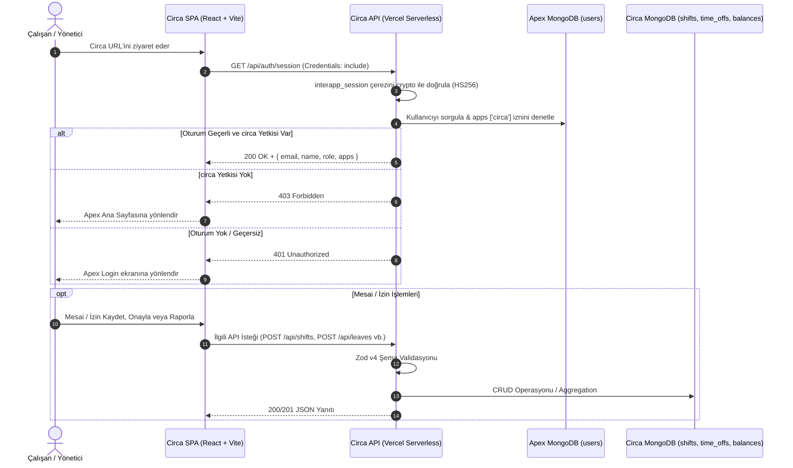

# Circa - Teknik Dokümantasyon

Bu doküman, **Circa** mesai ve izin takip sisteminin teknik mimarisini, veritabanı şemalarını, serverless API spesifikasyonlarını, güvenlik katmanlarını ve istemci mimarisini derinlemesine ayrıntılandırmaktadır.

---

## 🏗️ 1. Mimari Genel Bakış

Circa, bağımsız bir mikro-ön yüz (SPA) ve sunucusuz (Serverless) arka yüz fonksiyonlarından oluşur. Kullanıcı kimlik doğrulama ve merkezi hesap yönetiminde **Apex Hub**'a bağlıdır.



### 1.1 Ortam Ayrımı ve Dinamik Veritabanı Seçimi (`lib/mongodb.js`)
Circa, canlı ortam (Production) ile test/önizleme ortamları arasında tam veri izolasyonu uygular:

- **Canlı Ortam Belirleme (`isProdEnv`):**
  - `process.env.VERCEL_ENV === 'production'` veya `process.env.FORCE_PROD_DB === 'true'`
- **Dinamik Veritabanı Adlandırması (`getDbName`):**
  - **Üretim:** `Circa_db` ve `Apex_db`
  - **Önizleme / Geliştirme:** `Circa_test_db` ve `Apex_test_db`
- **Çerez İzolasyonu (`getSessionCookieName`):**
  - **Üretim:** `interapp_session`
  - **Önizleme / Geliştirme:** `interapp_session_test`

---

## 📂 2. Derinlemesine Dizin Yapısı

```
Circa/
├── api/                             # Vercel Serverless Fonksiyonları
│   ├── auth/
│   │   └── session.js               # GET: Oturum kontrolü, DELETE/POST: Çerez temizleme
│   ├── leaves/
│   │   ├── approve.js               # POST: Yönetici izin onaylama & negatif bakiye kaydı
│   │   ├── balance.js               # GET: Kullanıcı bakiye aggregation sorgusu
│   │   └── index.js                 # GET: İzinleri listele, POST: Yeni izin talebi, DELETE: İptal
│   ├── lib/
│   │   └── auth.js                  # verifyUser yardımcı fonksiyonu
│   └── shifts/
│       ├── index.js                 # GET: Mesaileri listele, POST: Mesai ekle, DELETE: Mesai sil
│       ├── process.js               # POST: Aylık mesaileri katsayı ile bakiyelere işle (Admin)
│       └── status.js                # GET: Seçili ayın işlenme durumunu sorgula
├── lib/                             # Arka Yüz Paylaşılan Çekirdek Kütüphaneleri
│   ├── auth.js                      # JWT doğrulama, crypto timingSafeEqual, role & app izinleri
│   └── mongodb.js                   # MongoDB Singleton bağlantısı, DB ve Çerez isim çözücüleri
├── public/                          # Statik Varlıklar
│   ├── Tinos-Bold.ttf               # jsPDF Türkçe destekli Serif Kalın font
│   └── Tinos-Regular.ttf            # jsPDF Türkçe destekli Serif Normal font
├── src/                             # React İstemci Uygulaması
│   ├── components/
│   │   ├── AddShiftForm.jsx         # Mesai kayıt formu bileşeni
│   │   ├── LeaveForm.jsx            # İzin talep formu (Tam gün / Saatlik)
│   │   ├── MultiSelectCalendar.jsx  # Timezone-safe çoklu tarih seçim takvimi
│   │   ├── RecentLeaves.jsx         # İzin hareketleri tablosu, onay/iptal & dilekçe indirme
│   │   └── RecentShifts.jsx         # Mesai hareket kartları ve silme aksiyonu
│   ├── context/
│   │   └── AuthContext.jsx          # Apex SSO kullanıcı context sağlayıcısı ve login yönlendirmesi
│   ├── pages/
│   │   ├── LeaveTracking.jsx        # İzin Yönetimi ana sayfası (`/permissions`)
│   │   └── Reports.jsx              # Raporlama, CSV/PDF ihracı ve ay işleme sayfası (`/reports`)
│   ├── utils/
│   │   └── pdf/
│   │       ├── generateLeavePetition.js # Resmi İzin Dilekçesi PDF üretim motoru
│   │       └── generateShiftPetition.js # Resmi Mesai İcmal Dilekçesi PDF üretim motoru
│   ├── App.jsx                      # Ana router, navigasyon çubuğu ve dashboard
│   ├── index.css                    # Tailwind CSS direktifleri
│   └── main.jsx                     # React DOM bağlayıcı
├── package.json                     # Paket manifesti ve komutlar
├── postcss.config.js                # PostCSS yapılandırması
├── tailwind.config.js               # Tailwind CSS tema yapılandırması
├── vercel.json                      # Vercel SPA rewrites yapılandırması
└── vite.config.js                   # Vite derleyici & Serverless middleware emülatörü
```

---

## 🗄️ 3. Veritabanı ve Şema Spesifikasyonu

Circa, verilerini MongoDB üzerinde 3 ana koleksiyonda depolar:

### 3.1 `shifts` Koleksiyonu (Mesai Kayıtları)
Personelin günlük olarak gerçekleştirdiği fazla mesai ve vardiya kayıtlarını saklar.

| Alan Adı | Veri Tipi | Zorunlu? | Açıklama |
| :--- | :--- | :---: | :--- |
| `_id` | `ObjectId` | Evet | MongoDB benzersiz kayıt kimliği |
| `name` | `String` | Evet | Personelin Adı Soyadı (Oturum açan kullanıcıdan alınır) |
| `email` | `String` | Evet | Personelin kurumsal e-posta adresi |
| `date` | `String` | Evet | Mesai tarihi (`YYYY-MM-DD` formatında saf string) |
| `shiftType` | `String` | Evet | Mesai türü: `'weekday'` \| `'weekend'` \| `'holiday'` |
| `startTime` | `String` | Evet | Başlangıç saati (`HH:MM` formatında) |
| `endTime` | `String` | Evet | Bitiş saati (`HH:MM` formatında) |
| `description` | `String` | Hayır | Mesai esnasında yapılan işlerin özeti |
| `createdAt` | `Date` | Evet | Kaydın sisteme eklenme zaman damgası |

> [!NOTE]
> `date` alanının `ISODate` yerine `YYYY-MM-DD` string olarak saklanması bilinçli bir mimari tercihtir. Bu sayede istemci ile sunucu arasındaki UTC zaman dilimi kaymaları tamamen engellenir.

### 3.2 `time_offs` Koleksiyonu (İzin Talepleri)
Personelin oluşturduğu tam gün veya saatlik izin taleplerini tutar.

| Alan Adı | Veri Tipi | Zorunlu? | Açıklama |
| :--- | :--- | :---: | :--- |
| `_id` | `ObjectId` | Evet | MongoDB benzersiz kayıt kimliği |
| `name` | `String` | Evet | İzin talep eden personelin Adı Soyadı |
| `email` | `String` | Evet | Personelin e-posta adresi |
| `unit` | `String` | Evet | İzin birimi: `'daily'` (Tam gün) veya `'hourly'` (Saatlik) |
| `dates` | `Array<Date>` | Hayır | `unit === 'daily'` durumunda seçilen günlerin tarih listesi |
| `singleDate` | `Date` | Hayır | `unit === 'hourly'` durumunda iznin kullanılacağı tekil gün |
| `startTime` | `String` | Hayır | `unit === 'hourly'` başlangıç saati (`HH:MM`) |
| `endTime` | `String` | Hayır | `unit === 'hourly'` bitiş saati (`HH:MM`) |
| `totalHours` | `Number` | Evet | Sunucu tarafından hesaplanan toplam saat (gün başı 8 saat veya saat farkı) |
| `description` | `String` | Hayır | İzin talep gerekçesi |
| `status` | `String` | Evet | İzin durumu: `'pending'` \| `'approved'` \| `'rejected'` |
| `createdAt` | `Date` | Evet | Talebin oluşturulma zaman damgası |
| `approvedAt` | `Date` | Hayır | Talebin yönetici tarafından onaylanma tarihi |
| `approvedBy` | `String` | Hayır | Onaylayan yöneticinin e-posta adresi |

### 3.3 `balances` Koleksiyonu (İzin Hak Ediş ve Bakiye Hareketleri)
Personelin fazla mesailerden kazandığı hak edişler ile izin kullanımlarından doğan düşümleri kaydeder. İki farklı tipte kayıt içerir:

#### A) Aylık Mesai Hak Ediş Kaydı (`api/shifts/process.js`)
```json
{
  "_id": "ObjectId(...)",
  "name": "Oğuzhan Çart",
  "email": "oguzhan@wildtype.app",
  "period": "2026-10",
  "totalHours": 27.2,
  "processedAt": "2026-10-31T11:00:00.000Z"
}
```
*Not: `email` ve `period` bileşik anahtarı ile upsert edilir; bir ay tekrar işlendiğinde mevcut kayıt ezilir.*

#### B) İzin Kullanım Düşüm Kaydı (`api/leaves/approve.js`)
```json
{
  "_id": "ObjectId(...)",
  "name": "Oğuzhan Çart",
  "email": "oguzhan@wildtype.app",
  "type": "usage",
  "totalHours": -8.0,
  "requestId": "ObjectId('65421...')",
  "description": "İzin Kullanımı: 1 Gün",
  "processedAt": "2026-10-31T11:30:00.000Z"
}
```

#### Bakiye Sorgulama Aggregation Pipeline'ı (`api/leaves/balance.js`)
Personelin anlık net izin bakiyesi şu pipeline ile hesaplanır:
```javascript
const pipeline = [
    { $match: { email: targetEmail } },
    { $group: { _id: null, totalBalance: { $sum: '$totalHours' } } }
];
```

---

## 🔌 4. Kapsamlı API Referansı

Tüm API uçları `interapp_session` çerezini zorunlu kılar.

### 4.1 Oturum API (`/api/auth/session`)

#### `GET /api/auth/session`
Mevcut kullanıcının oturum bilgilerini döner.
- **Yetki:** Giriş yapmış kullanıcı (`apps` listesinde `circa` olmalı).
- **Başarılı Yanıt (200 OK):**
  ```json
  {
    "email": "personel@wildtype.app",
    "name": "Ahmet Yılmaz",
    "role": "user",
    "apps": ["circa", "labproject"]
  }
  ```
- **Hata Yanıtları:**
  - `401 Unauthorized`: `{ "error": "Oturum bulunamadı." }`
  - `403 Forbidden`: `{ "error": "Bu uygulamaya erişim yetkiniz bulunmamaktadır." }`

#### `DELETE /api/auth/session` veya `POST /api/auth/session`
Oturumu kapatır ve `interapp_session` çerezini Max-Age=0 ile temizler.
- **Başarılı Yanıt (200 OK):** `{ "message": "Logged out" }`

---

### 4.2 Mesai API (`/api/shifts`)

#### `GET /api/shifts`
Mesai kayıtlarını listeler.
- **Query Parametreleri:**
  - `limit` (opsiyonel, varsayılan: `5`): Döndürülecek maksimum kayıt.
  - `month` & `year` (opsiyonel): Belirtilen ay ve yıl için tüm kayıtları çeker (`date: { $regex: ^YYYY-MM }`). Kronolojik sıralanır.
- **Yetki Kuralları:** `admin` rolü tüm personelin mesailerini görür; normal kullanıcılar sadece kendi kayıtlarını görür (`email: user.email`).
- **Başarılı Yanıt (200 OK):**
  ```json
  [
    {
      "_id": "672365fa1a2b3c4d5e6f7a8b",
      "name": "Ahmet Yılmaz",
      "email": "ahmet@wildtype.app",
      "date": "2026-10-15",
      "shiftType": "weekday",
      "startTime": "09:00",
      "endTime": "18:00",
      "description": "Hücre kültürü pasajlama",
      "createdAt": "2026-10-15T15:30:00.000Z"
    }
  ]
  ```

#### `POST /api/shifts`
Yeni mesai kaydı oluşturur.
- **Zod Doğrulama Şeması (`shiftPostSchema`):**
  ```javascript
  z.object({
      date: z.string().regex(/^\d{4}-\d{2}-\d{2}$/, 'Tarih YYYY-MM-DD formatında olmalıdır.'),
      shiftType: z.enum(['weekday', 'weekend', 'holiday']),
      startTime: z.string().regex(/^\d{2}:\d{2}$/, 'Başlangıç saati HH:MM formatında olmalıdır.'),
      endTime: z.string().regex(/^\d{2}:\d{2}$/, 'Bitiş saati HH:MM formatında olmalıdır.'),
      description: z.string().optional().default('')
  })
  ```
- **Başarılı Yanıt (201 Created):** Eklenen mesai nesnesi döner.
- **Hata Yanıtları:**
  - `400 Bad Request`: Validasyon hatası.

#### `DELETE /api/shifts?id={shiftId}`
Belirtilen mesai kaydını siler.
- **Yetki Kuralları:**
  - Yalnızca kaydın sahibi veya `admin` silebilir.
  - **Dönem Kilitleme Koruması:** Eğer silinmek istenen mesainin ait olduğu ay (`period: YYYY-MM`) daha önce `balances` koleksiyonuna işlenmişse ve kullanıcı `admin` değilse silme işlemi reddedilir.
- **Başarılı Yanıt (200 OK):**
  ```json
  {
    "success": true,
    "periodProcessed": false
  }
  ```
- **Hata Yanıtları:**
  - `400 Bad Request`: `"Bu aya ait mesailer bakiyeye işlendiği için kayıt silinemez. Lütfen yöneticinizle iletişime geçin."`
  - `403 Forbidden`: `"Yalnızca kendi mesai kayıtlarınızı silebilirsiniz."`
  - `404 Not Found`: `"Mesai kaydı bulunamadı."`

---

### 4.3 Aylık Mesai Katsayı İşleme Motoru (`/api/shifts/process`)

#### `POST /api/shifts/process`
Belirtilen ay ve yıla ait tüm mesaileri tarar, personelin fiili çalışma saatlerini katsayılarla çarpar ve `balances` koleksiyonuna yazar.
- **Yetki:** Yalnızca `admin` rolü.
- **İstek Gövdesi:**
  ```json
  {
    "month": 10,
    "year": 2026
  }
  ```
- **Hesaplama Algoritması:**
  1. Gece vardiyası kontrolü: `hours = (end - start) / 3600000; if (hours < 0) hours += 24;`
  2. UTC gün tespiti: `const dayOfWeek = new Date(Date.UTC(yr, mo - 1, dy)).getUTCDay();`
  3. Çarpan ataması:
     - `shiftType === 'holiday' || dayOfWeek === 0` (Pazar) ➔ **`3.0`**
     - Diğer günler (Hafta içi ve Cumartesi) ➔ **`1.7`**
  4. `weightedHours = hours * multiplier`
  5. `balances` koleksiyonuna `{ email, period }` anahtarı üzerinden bulk upsert.
- **Başarılı Yanıt (200 OK):**
  ```json
  {
    "message": "Mesailer başarıyla işlendi.",
    "processedCount": 5,
    "details": [
      {
        "name": "Ahmet Yılmaz",
        "email": "ahmet@wildtype.app",
        "totalHours": 34.0,
        "period": "2026-10",
        "processedAt": "2026-10-31T12:00:00.000Z"
      }
    ]
  }
  ```

---

### 4.4 Rapor Durum Kontrolü (`/api/shifts/status`)

#### `GET /api/shifts/status?month={month}&year={year}`
Seçilen ayın daha önce işlenip işlenmediğini denetler.
- **Başarılı Yanıt (200 OK):**
  ```json
  {
    "processed": true,
    "count": 5,
    "lastProcessedAt": "2026-10-31T12:00:00.000Z"
  }
  ```

---

### 4.5 İzin API (`/api/leaves`)

#### `GET /api/leaves`
İzin taleplerini listeler.
- **Query Parametreleri:** `limit` (opsiyonel, 1 ile 200 arası, varsayılan: 10).
- **Yetki Kuralları:** `admin` tüm personelin taleplerini görür; çalışanlar yalnızca kendi taleplerini görür.
- **Başarılı Yanıt (200 OK):** `time_offs` listesi.

#### `POST /api/leaves`
Yeni izin talebi oluşturur.
- **Zod Doğrulama Şeması (`leavePostSchema`):**
  ```javascript
  z.object({
      unit: z.enum(['daily', 'hourly']),
      dates: z.array(z.string().regex(/^\d{4}-\d{2}-\d{2}/)).optional().default([]),
      singleDate: z.string().regex(/^\d{4}-\d{2}-\d{2}/).nullable().optional(),
      startTime: z.string().regex(/^([01]\d|2[0-3]):([0-5]\d)$/).nullable().optional(),
      endTime: z.string().regex(/^([01]\d|2[0-3]):([0-5]\d)$/).nullable().optional(),
      description: z.string().optional().default('')
  })
  ```
- **Sunucu Tarafı Süre Hesabı:**
  - `daily`: Benzersiz gün sayısı $\times 8$ saat.
  - `hourly`: `(bitiş dakikası - başlangıç dakikası) / 60` saat.
- **Başlangıç Durumu:** Her talep varsayılan olarak `status: 'pending'` olarak kaydedilir.
- **Başarılı Yanıt (201 Created):** Eklenen izin talebi nesnesi.

#### `DELETE /api/leaves`
İzin talebini iptal eder ve siler.
- **Parametre:** `id` (Body veya Query içerisinde).
- **Yetki & Kural:**
  - Sadece talebin sahibi veya `admin` iptal edebilir.
  - Yalnızca `status: 'pending'` durumundaki talepler silinebilir. Onaylanmış veya reddedilmiş kayıtlar silinemez.
- **Başarılı Yanıt (200 OK):** `{ "success": true, "message": "İzin talebi başarıyla iptal edildi." }`

---

### 4.6 İzin Onaylama ve Bakiye Düşümü (`/api/leaves/approve`)

#### `POST /api/leaves/approve`
Yöneticinin bekleyen izin talebini onaylamasını ve bakiyeden düşmesini sağlar.
- **Yetki:** Yalnızca `admin` rolü.
- **İstek Gövdesi:** `{ "id": "672365fa1a2b3c4d5e6f7a8b" }`
- **İşlem Adımları:**
  1. `time_offs` koleksiyonunda talep bulunur (`status === 'approved'` ise hata fırlatılır).
  2. `time_offs` belgesi güncellenir: `{ status: 'approved', approvedAt: new Date(), approvedBy: user.email }`.
  3. `balances` koleksiyonuna negatif bakiye kaydı eklenir:
     `totalHours = -1 * Math.abs(request.totalHours)`
- **Başarılı Yanıt (200 OK):** `{ "message": "İzin onaylandı ve bakiyeden düşüldü." }`

---

### 4.7 Bakiye Sorgulama API (`/api/leaves/balance`)

#### `GET /api/leaves/balance`
Giriş yapan kullanıcının veya yöneticinin sorguladığı personelin toplam net saatlik izin bakiyesini döner.
- **Query Parametreleri:** `email` (opsiyonel, yalnızca adminler için geçerlidir).
- **Başarılı Yanıt (200 OK):**
  ```json
  {
    "email": "personel@wildtype.app",
    "totalBalance": 19.2,
    "currency": "hours"
  }
  ```

---

## 💻 5. Frontend Mimarisi ve İstemci Bileşenleri

### 5.1 Rota Haritası (`react-router-dom` v7)
| Rota | Bileşen | Açıklama |
| :--- | :--- | :--- |
| `/` | `MainDashboard` (`AddShiftForm` + `RecentShifts`) | Mesai girişi ve son mesai hareketleri paneli |
| `/permissions` | `LeaveTracking` (`LeaveForm` + `RecentLeaves`) | İzin talebi oluşturma, onaylama, bakiye görüntüleme |
| `/reports` | `Reports` | Aylık mesai tablosu, Excel/CSV indir, Dilekçe indir, Ayı işle |

### 5.2 Timezone-Safe Takvim Tasarımı (`MultiSelectCalendar.jsx`)
Geleneksel JavaScript `new Date("2026-10-15")` ifadeleri yerel saat dilimine göre UTC gece yarısından önceki güne (örneğin Türkiye UTC+3'te 23:00'a) kayabilmektedir. 

Circa'da takvim hücreleri yerel saat manipülasyonundan izole edilmiştir:
- Yıl, ay ve gün doğrudan ayrıştırılarak string şablonu oluşturulur: `${year}-${month}-${day}`.
- Bileşen dışarıya sadece `YYYY-MM-DD` dizisi yayar (`onChange(newSelectedDates)`).
- Gösterim anında `dateString.includes('T') ? dateString.split('T')[0] : dateString` temizliği uygulanır.

### 5.3 PDF Raporlama ve Font Mimarisi (`src/utils/pdf/`)
jsPDF standart çekirdeğinde Türkçe karakterler (Ğ, ğ, Ş, ş, İ, ı) bozuk çıkmaktadır. Circa, bu sorunu `public/` dizininde barındırılan **Tinos Serif** fontlarını Base64 olarak sanal dosya sistemine (`doc.addFileToVFS`) kaydederek çözer:

1. **`generateShiftPetition.js` (Aylık Mesai İcmal Dilekçesi):**
   - İstanbul Medeniyet Üniversitesi İMU DEHAL formatına tam uygun kurumsal üst yazı.
   - `jspdf-autotable` ile taşma korumalı mesai dökümü tablosu.
   - Sayfa sonu marj kontrolü: İcmal ve imza alanları sayfa sınırını (250pt/280pt) aştığında otomatik `doc.addPage()` çağrısı ile imza taşması engellenir.
2. **`generateLeavePetition.js` (İzin Talep Dilekçesi):**
   - Çalışanın anlık hak ediş bakiyesini dinamik olarak metne gömer.
   - Talep edilen tarih aralığı ve saat miktarını resmi dilekçe formatında hazırlar ve tek tıkla indirir.

### 5.4 CSV Güvenliği (CSV Formula Injection Koruması)
`Reports.jsx` içerisindeki Excel dışa aktarım fonksiyonunda formül enjeksiyonu koruması uygulanmıştır:
```javascript
const escapeCsvCell = (val) => {
    const str = String(val ?? '');
    // Eğer hücre =, +, -, @ gibi formül tetikleyicilerle başlıyorsa tek tırnak eklenir
    const safeStr = /^[=+\-@]/.test(str) ? `'${str}` : str;
    return `"${safeStr.replace(/"/g, '""')}"`;
};
```
UTF-8 karakterlerin Excel'de doğru açılması için dosya başına `\uFEFF` (Byte Order Mark - BOM) eklenir.

---

## ⚙️ 6. Ortam Değişkenleri (.env Referansı)

| Değişken Adı | Zorunlu? | Varsayılan | Açıklama |
| :--- | :---: | :--- | :--- |
| `MONGODB_URI` | **Evet** | - | MongoDB bağlantı bağlantı dizesi |
| `JWT_SECRET` | **Evet** | - | Apex SSO ile paylaşılan JWT simetrik anahtarı |
| `NODE_ENV` | Hayır | `development` | Çalışma ortamı (`development` veya `production`) |
| `VERCEL_ENV` | Hayır | - | Vercel dağıtım ortamı (`production`, `preview`, `development`) |
| `FORCE_PROD_DB`| Hayır | `false` | Geliştirme ortamında zorla `Circa_db` kullanmak için `true` |

---

## 🔒 7. Hata Yönetimi ve Güvenlik Mekanizmaları

1. **Kimlik ve Rol Doğrulama Akışı (`verifyAuthWithStatus`):**
   - Çerez parse edilir (`interapp_session` veya `interapp_session_test`).
   - Algoritma kontrolü yapılır (`alg === 'HS256'`).
   - Zaman aşımı (`exp`) kontrol edilir.
   - `Apex_db.users` koleksiyonundan kullanıcı bulunur.
   - `hasRequiredAppAccess`: Kullanıcı `admin` değilse, `apps` dizisinde `'circa'` anahtarının varlığı kontrol edilir. Yoksa `403 Forbidden` döner.
2. **Geliştirme Modu Koruması:**
   - Authorization Bearer bypass'ı kesinlikle yalnızca yerel geliştirme modunda (`process.env.NODE_ENV === 'development' && !process.env.VERCEL_ENV`) aktiftir. Canlı sunucularda (Vercel) bu bypass tamamen devre dışıdır.
3. **HTTP Metot İzolasyonu:**
   - İzin verilmeyen metotlar anında `405 Method Not Allowed` ve `Allow` başlığı ile sonlandırılır.
